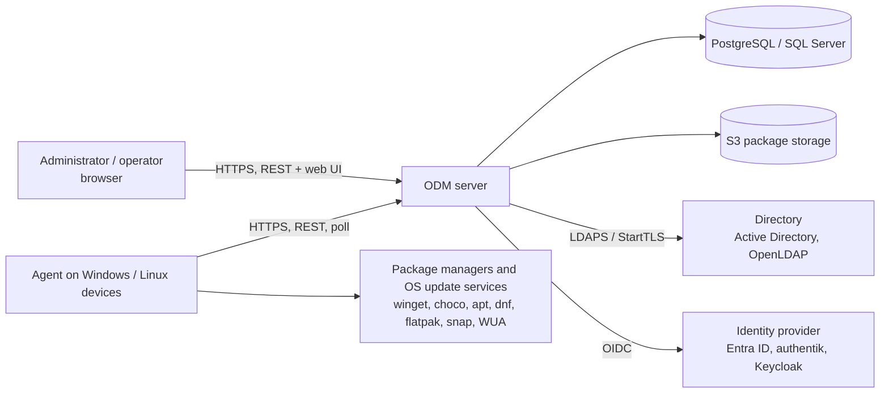
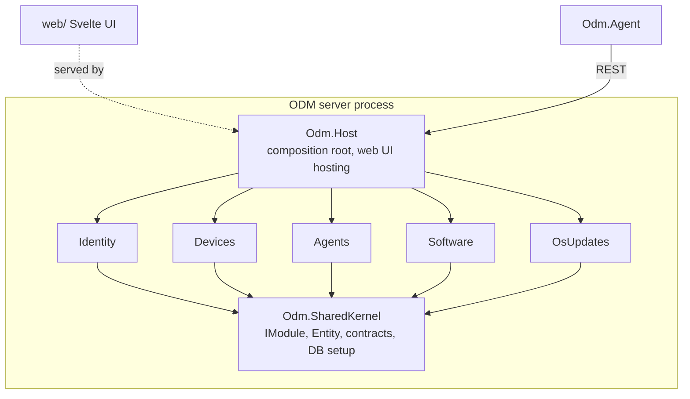
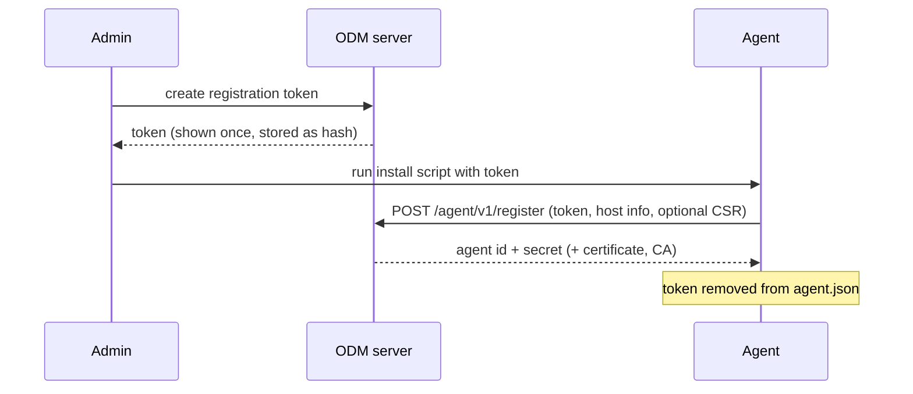
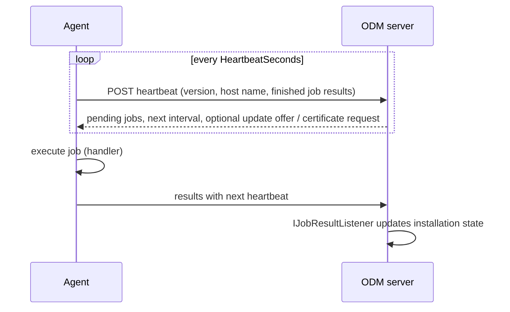
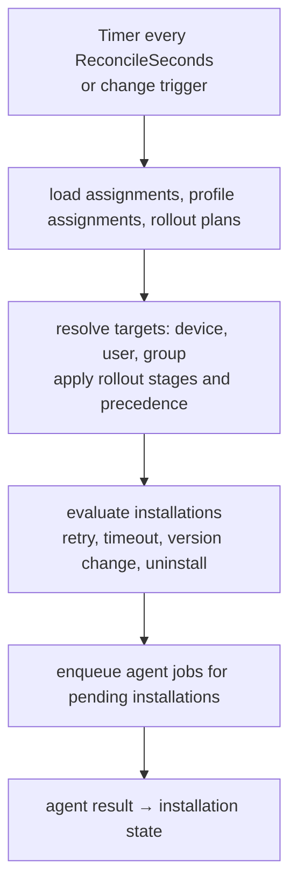
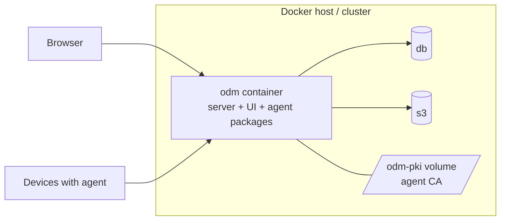

# ODM architecture (arc42)

Structure follows [arc42](https://arc42.org). Diagrams use Mermaid (rendered by GitHub and most Markdown viewers).

## 1. Introduction and goals

Open Device Manager (ODM) is a free alternative to Microsoft Configuration Manager / Intune. It supports IT teams in managing
Windows and Linux devices. Full requirements: [REQUIREMENTS.md](../../REQUIREMENTS.md) .

### 1.1 Requirements overview

| Area | Capability |
|---|---|
| Device management | inventory, primary user, cost centre, dynamic groups (name, OS, version, org unit of the primary user) |
| Software distribution | PSADT packages (S3), repository packages (Winget, Chocolatey, APT, RPM, Flatpak, Snap), secrets, profiles, staged rollouts, uninstall |
| OS updates | policies and maintenance windows per device or group |
| Agent | installation by script, self-update, optional client certificates (mTLS) |
| Operations | Docker / Kubernetes, PostgreSQL or SQL Server, German / English UI with dark mode, REST API |
| Reporting | dashboard with deployment statistics, failures and devices without heartbeat |

### 1.2 Quality goals

| Priority | Goal | Meaning |
|---|---|---|
| 1 | Security | agents and admins are authenticated; secrets are encrypted; no inbound connection to devices; TLS everywhere |
| 2 | Maintainability | modular monolith with strict module boundaries, small dependency footprint, tests for domain logic |
| 3 | Operability | one container image, configuration through environment variables, automatic migrations, rotating agent logs |
| 4 | Robustness | agents tolerate server outages (backoff), jobs are retried, failed agent updates roll back |
| 5 | Portability | PostgreSQL and SQL Server, Windows and Linux agents (x64, ARM64) |

### 1.3 Stakeholders

| Role | Expectation |
|---|---|
| IT administrator | simple installation, reliable rollouts, clear status and error messages |
| Operator | assign software and updates, reset failed jobs, read results |
| Security officer | traceable authentication, protected secrets, least privilege |
| Developer | clear module boundaries, reproducible build, documented decisions |

## 2. Constraints

| Constraint | Background |
|---|---|
| Backend C# (.NET 10 LTS), agent C# | requirement; one language for server and agent |
| Web UI in TypeScript | requirement; implemented with Svelte 5 and Vite |
| PostgreSQL **or** SQL Server | requirement; selected by configuration |
| Docker or Kubernetes | requirement; Docker Compose and Helm chart available |
| Agent for Windows (client and server) and Linux (DEB and RPM) | requirement |
| PSADT packages on S3-compatible storage | requirement |
| REST between UI, API and agent | requirement |
| Documentation and log messages in English; UI in German and English | project convention |
| Minimal third-party libraries | keep the supply chain small |

## 3. Context and scope

### 3.1 Business context



### 3.2 Technical context

| Interface | Protocol | Notes |
|---|---|---|
| Web UI ↔ server | HTTPS, JSON REST under `/api`, static files | bearer JWT |
| Agent ↔ server | HTTPS, JSON REST under `/api/agent/v1` | `Authorization: Agent <id>.<secret>`; optional client certificate |
| Server ↔ database | EF Core (Npgsql / SqlClient) | one schema per module |
| Server ↔ S3 | AWS S3 API | path-style addressing for self-hosted stores |
| Server ↔ directory | LDAP over TLS | bind-as-user verification |
| Server ↔ IdP | OpenID Connect | authorization code + PKCE |

## 4. Solution strategy

| Goal | Approach |
|---|---|
| Maintainability | modular monolith; modules depend only on the shared kernel and talk through contracts |
| Security | pull-based agents (no inbound ports), hashed one-time tokens and agent secrets, optional mTLS with own CA, AES-GCM for secrets |
| Scalability of rollouts | declarative desired state plus a reconciliation loop instead of imperative per-device commands |
| Operability | single image (UI, server, agent packages), configuration by environment, migrations applied on start |
| Portability | provider switch for the database with provider-specific migration sets |
| Robustness | idempotent jobs, bounded retries, rollback of failed agent updates |

## 5. Building block view

### 5.1 Level 1: system



| Building block | Responsibility |
|---|---|
| `Odm.Host` | ASP.NET Core host; registers modules in order, maps their endpoints under `/api`, serves the UI |
| `Odm.SharedKernel` | `IModule`, `Entity`, authorisation policies, database configuration, cross-module contracts (`IDeviceRegistry`, `IDeviceDirectory`, `IJobQueue`, `IJobResultListener`) |
| `Identity` | local users (PBKDF2), JWT issuing, LDAP and OIDC authentication providers |
| `Devices` | device inventory, assignment (primary user, org unit, cost centre), dynamic groups, device statistics |
| `Agents` | registration tokens, agent credentials and certificates, job queue, agent protocol, agent package and install script delivery, self-update planning |
| `Software` | packages and versions (S3), assignments, profiles, rollouts, secrets, reconciliation, installation state, deployment statistics |
| `OsUpdates` | update policies, maintenance windows, scheduling of update runs, run log |
| `Odm.Agent` | worker service: registration, heartbeat, job executor and handlers (ping, install PSADT, install repository package, OS update), self-updater, file logger |
| `web/` | Svelte 5 single-page application, hash router, own data table component, i18n (de/en), theme |

### 5.2 Level 2: module structure

Each module follows the same layout:

```
Domain/          entities and state machines (e.g. Installation, AgentCredential)
Application/     services, contracts (DTOs), options, background logic
Infrastructure/  DbContext, migrations, external adapters (S3, LDAP, OIDC)
Endpoints/       minimal API endpoint groups
<Name>Module.cs  IModule: service registration, endpoint mapping, initialisation
```

Rules: modules never reference each other; each owns a schema (`identity`, `devices`, `agents`, `software`, `osupdates`) and a
migration history; cross-module calls use `Odm.SharedKernel/Contracts` (for example `Software` enqueues jobs through
`IJobQueue`, implemented by `Agents`, and receives results through `IJobResultListener`, implemented by `Software`).

## 6. Runtime view

### 6.1 Agent registration



### 6.2 Heartbeat and job execution



### 6.3 Software reconciliation



### 6.4 Sign-in

Local: password verified with PBKDF2, JWT issued. LDAP: search, bind as user, role from groups. OIDC: authorization code flow with
PKCE; the server validates the ID token and issues its own JWT, which reaches the UI in the URL fragment.

## 7. Deployment view



- One image (multi-stage build: web, server, agent packages). Docker Compose files: `docker-compose.yml` (PostgreSQL) and
  `deploy/docker-compose.mssql.yml` (SQL Server), `deploy/docker-compose.https.yml` (Caddy reverse proxy with TLS). The Helm chart `deploy/helm/odm` deploys a single ODM instance for Kubernetes.
- Agents run as a Windows service or systemd unit (`deploy/odm-agent.service`).
- State to back up: database, S3 bucket, `ODM_SECRETS_KEY`, CA volume. See [operations](../operations.md).

## 8. Cross-cutting concepts

| Concept | Approach |
|---|---|
| Authentication | JWT bearer for users (local, LDAP, OIDC); `Agent` scheme for agents (secret hash, optional client certificate) |
| Authorisation | roles `Admin`, `Operator`, `ReadOnly` expressed as policies in the shared kernel |
| Persistence | EF Core, one DbContext and schema per module, provider-specific migration sets, automatic migration on start |
| Desired vs actual state | assignments are the desired state; one `Installation` per (device, package) is the actual state; a background reconciler closes the gap |
| Jobs | persisted job queue per device; at-least-once delivery, results idempotent; bounded retries |
| Secrets | AES-256-GCM, master key from configuration; referenced as `{{secret:NAME}}`, resolved by the agent at execution, redacted from output |
| Configuration | `appsettings.json` + environment variables; validated at start (e.g. JWT secret length) |
| Logging | structured `ILogger`; messages in English; the agent also writes a rotating file; no secrets or command lines |
| i18n | UI strings in `i18n.svelte.ts` (de/en); server messages for the UI are English or localised in the UI |
| Error handling | agents retry with exponential backoff and jitter; failed jobs keep the tail of the output (up to 64 000 characters) |
| Testing | unit tests for domain logic and pure functions; no database or network in tests |
| Rate limiting | policies for sign-in, agent registration and install-script downloads |

## 9. Architecture decisions

| ID | Decision | Reason / consequences | Status |
|---|---|---|---|
| ADR-01 | Modular monolith instead of microservices | simple operation and deployment, clear boundaries enforced by project references; modules could be split later | accepted |
| ADR-02 | Modules reference only the shared kernel; cross-module calls via contracts | keeps modules independent; some indirection (`IJobQueue`, `IDeviceDirectory`) | accepted |
| ADR-03 | One DB schema and migration history per module | independent evolution, easy to see ownership; more migrations to maintain | accepted |
| ADR-04 | PostgreSQL and SQL Server, selected by configuration, with **separate provider-specific migration sets** | portability requirement; every model change needs two migrations; no data migration between the databases | accepted |
| ADR-05 | EF Core as ORM; group rules compiled to expression trees that EF translates to SQL | same filter semantics in the list, preview and membership checks; limited to translatable operators | accepted |
| ADR-06 | Svelte 5 + TypeScript + Vite, no UI component library; own data table | small bundle and dependency set; more own UI code | accepted |
| ADR-07 | User sessions use short-lived JWT bearer tokens kept in `sessionStorage` | stateless server, tab-scoped sessions; no server-side revocation before expiry | accepted |
| ADR-08 | Local accounts use PBKDF2-HMAC-SHA256 (600 000 iterations) | built into .NET, no extra dependency | accepted |
| ADR-09 | LDAP verifies passwords by binding as the user; roles come from direct group membership; TLS mandatory | no password handling in ODM; nested groups are not resolved | accepted |
| ADR-10 | OpenID Connect replaces the OData authentication endpoint from the initial requirements | standard SSO for Entra ID, authentik, Keycloak; authorization code + PKCE; state kept in a signed cookie so several instances work | accepted |
| ADR-11 | Agents poll the server (heartbeat); the server never connects to devices | works through NAT and firewalls, no inbound ports on clients; latency bounded by heartbeat interval | accepted |
| ADR-12 | Agents enroll with a one-time token and then use a random per-agent secret stored only as hash | limits damage of a leaked token; reinstall revokes the old credentials | accepted |
| ADR-13 | Optional mTLS with an ODM-owned CA (ECDSA P-256), CA stored as files in a volume, certificate bound to the agent credential by thumbprint, modes Off / Optional / Required | stolen secret alone is insufficient; the agent key never leaves the device; TLS must terminate at ODM; the CA volume needs backup | accepted |
| ADR-14 | Certificates are issued only over a direct TLS connection | prevents lock-out when enrolling through a proxy or plain HTTP | accepted |
| ADR-15 | Packages are stored in S3-compatible storage; agents download through the server, which checks for a matching job | no S3 credentials or presigned URLs on devices; server streams data | accepted |
| ADR-16 | Declarative desired state with a periodic reconciler (plus change trigger) | handles new group members, new versions and refresh of auto-updating packages uniformly; eventual consistency within the interval | accepted |
| ADR-17 | One installation record per (device, package) with bounded retries (3 attempts, 15 minutes apart) | simple state machine, easy to report; no full history | accepted |
| ADR-18 | Precedence of multiple sources: device before user before group; single assignment before profile | predictable result without priorities to maintain | accepted |
| ADR-19 | Staged rollouts via stable hash percentages or subgroups; only for new installations | selection only grows; devices already installed keep updating | accepted |
| ADR-20 | Secrets encrypted with AES-256-GCM; agent resolves them at run time and redacts output | secrets never in the job table; visible on the command line during install (documented limit) | accepted |
| ADR-21 | Repository packages: configuration changes create a *revision* of the package | devices reconcile to the new configuration; revision history is the audit trail of settings | accepted |
| ADR-22 | Uninstall is an *intent* of an assignment (Install / Uninstall), applied only where ODM installed the package | declarative like install; fits the reconciler; no ad-hoc per-device removal; not available for profiles | accepted |
| ADR-23 | Agent delivered as self-contained packages served by the ODM server, plus install scripts | no runtime install on devices, works offline from the internet; image grows by four platform packages | accepted |
| ADR-24 | Agent self-update controlled by server policy (Off / Latest / Pinned, percentage rollout), helper process with rollback | safe fleet-wide updates; a broken agent that cannot start needs manual repair | accepted |
| ADR-25 | OS updates: Windows Update Agent API via COM, Linux via apt / dnf / yum; restart only within the window | no extra modules on devices; behaviour differs per platform | accepted |
| ADR-26 | Job result messages keep the **tail** of the output, up to 64 000 characters | the failure reason is at the end of PSADT / installer logs; larger columns | accepted |
| ADR-27 | English for documentation and log messages; UI localised (de/en) | consistent operations language; UI for end users in their language | accepted |
| ADR-28 | Agent logs to a rotating file, journald / Event Log | troubleshooting without server access | accepted |
| ADR-29 | Helm chart deploys exactly one ODM replica; database optionally bundled, S3 always external | background services and the agent CA volume are not multi-instance safe yet; a managed DB / object store is the better production choice | accepted |
| ADR-30 | A trusted reverse proxy may forward the agent certificate in a header; trust is defined by `Proxy:TrustedProxies` and the original peer address, ODM still validates the certificate | mTLS works behind Caddy / ingress; ODM stays the only authority on validity; the proxy network must be isolated, otherwise the header could be forged | accepted |

## 10. Quality requirements

| Quality | Scenario | Measure |
|---|---|---|
| Security | stolen agent secret | mTLS mode Required makes the secret alone useless; credentials revocable by reinstall or certificate reset |
| Security | leaked registration token | single use, expires, rate limited |
| Reliability | server offline for hours | agents back off (max 5 minutes) and resume; jobs are redelivered |
| Reliability | broken agent update | helper restores the previous version; failed version not retried |
| Scalability | thousands of devices | heartbeat jitter, paged queries, batch job enqueue (500 per run) |
| Maintainability | add a module | implement `IModule`, register it in the host, no changes in other modules |
| Usability | find failures quickly | dashboard with failures and silent devices; full job messages in the UI |

## 11. Risks and technical debt

| Item | Impact | Mitigation / plan |
|---|---|---|
| No audit log | changes are not traceable | add an audit trail for assignments, deletions, resets |
| No notifications | failures and silent devices are visible only in the dashboard | e-mail / webhook alerts |
| No housekeeping | old jobs and results accumulate | retention settings and cleanup job |
| Winget with *user* scope installs for SYSTEM | not for signed-in users | user-context execution |
| No data migration between PostgreSQL and SQL Server | switching databases loses data | export / import tool if needed |
| Pending EF model changes stop the server | forgotten migrations are noticed at start | documented in [development](../development.md) |
| SQL Server provider not tested end to end | SQL Server migrations and queries are only covered by unit tests; provider differences may surface in operation | integration test run against SQL Server (Testcontainers or CI service) covering migrations, startup and the main flows |
| Helm chart not tested on a cluster | template or configuration errors appear only at the first `helm install` | `helm lint` / `helm template` in CI, deployment test on a test cluster (e.g. kind) |
| Forwarded client certificate not tested end to end | header formats and proxy settings (Caddy, ingress-nginx) are covered by unit tests only | integration test with Caddy and a real agent; verify the ingress-nginx settings on a cluster |
| No load test | behaviour with thousands of agents (heartbeats, job delivery, reconciler, dashboard queries) is assumed, not measured | load test with simulated agents; derive sizing guidance and tune indexes / intervals |

## 12. Glossary

| Term | Meaning |
|---|---|
| Agent | worker service on a managed device |
| Assignment | desired state: a package or profile (with an action) for a device, user or group |
| Installation | actual state of one package on one device |
| Job | unit of work queued for one agent (ping, install, OS update) |
| Profile | ordered list of packages installed in sequence |
| Revision | snapshot of a repository package's configuration |
| Rollout / stage | gradual release of a new assignment by percentage or subgroup |
| Reconciler | background service that compares desired and actual state and enqueues jobs |
| PSADT | PowerShell App Deployment Toolkit |
| mTLS | mutual TLS: the agent authenticates with a client certificate |
